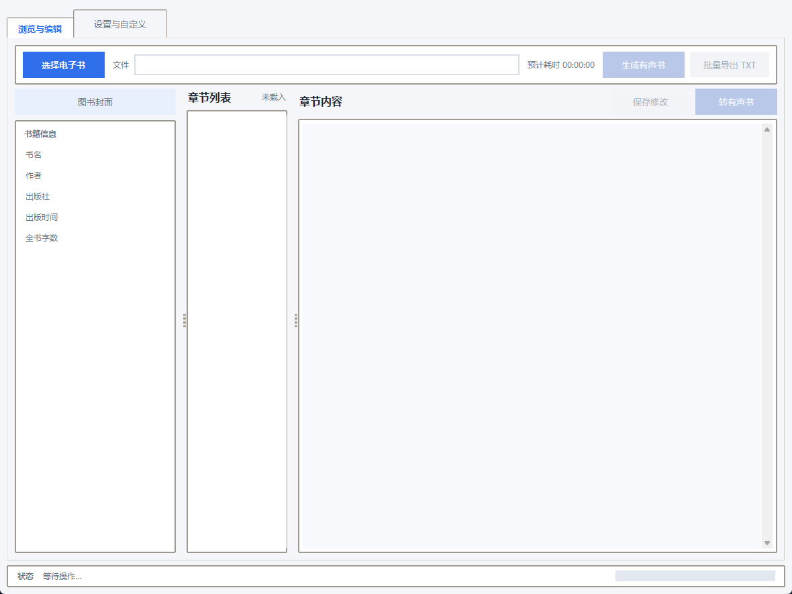
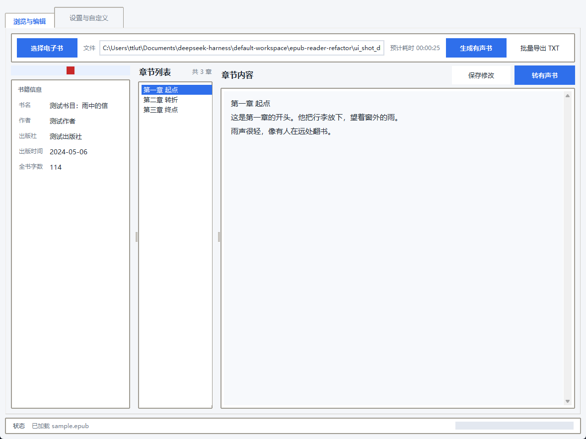
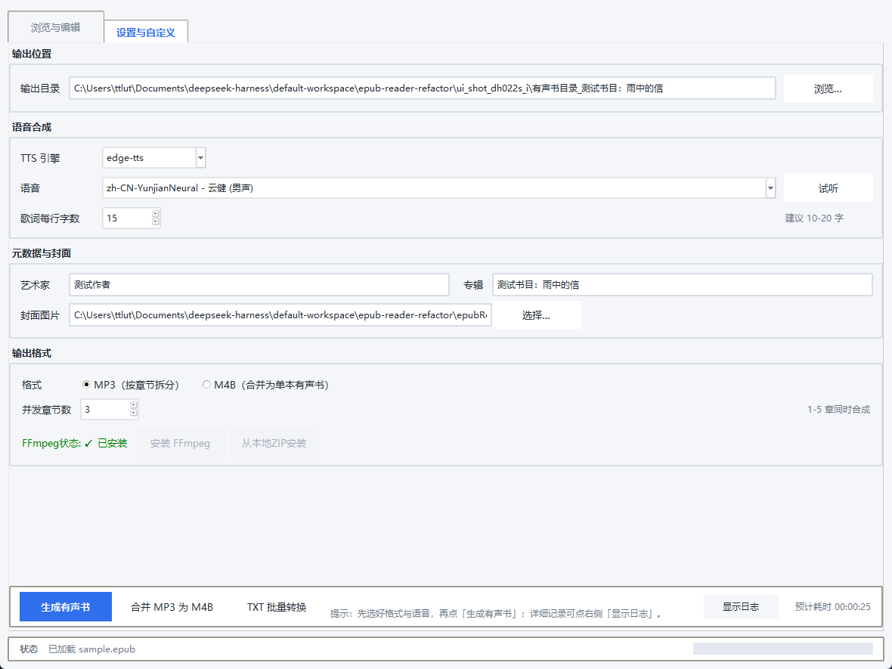
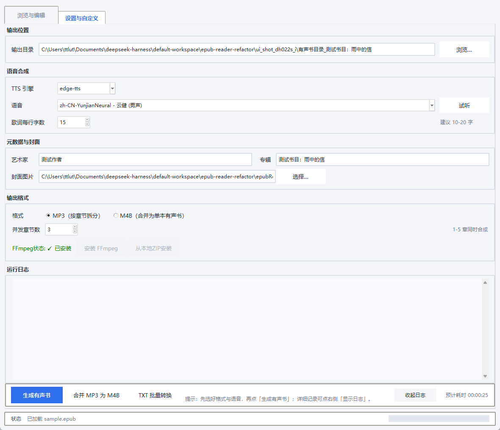

# epubReader · EPUB 有声书制作

把 EPUB / TXT 电子书转成有声书：调用微软 Edge 在线语音逐章合成 MP3，同时生成 LRC 字幕，
最后用 FFmpeg 合成带章节标记的 M4B。Windows 桌面程序，Tkinter 单文件实现，可打包成免安装 exe。

## 下载

不想装 Python 的话，直接下免安装单文件版：

| 版本 | 文件 | 说明 |
| --- | --- | --- |
| [v0.04](https://github.com/aiernike/epubReader/releases/download/v0.04/epub.reader.v0.04.exe) | `epub.reader.v0.04.exe` | **推荐**。内置 edge-tts 7.3.1，修复"转换失败（403）"与关闭时报错。约 22 MB |
| [v0.01](https://github.com/aiernike/epubReader/releases/tag/v0.01) | `epub.reader.exe` | 旧版，**内置的 edge-tts 已被微软拒绝，转换会失败**，仅作留档 |

双击即可运行，不需要安装。首次启动会慢两三秒（单文件版要先把自身解压到临时目录，属正常）。

**FFmpeg** 不在安装包里（会让体积翻十倍）：程序按
**随包目录 → `%APPDATA%\epubReader\ffmpeg\bin` → 系统 PATH** 顺序查找，
都没有时界面会提示一键联网下载。

## 界面

| 空状态 | 载入 EPUB 后 |
| --- | --- |
|  |  |

| 设置与自定义 | 展开日志 |
| --- | --- |
|  |  |

## 功能

- **EPUB → MP3**：按章拆分，逐章合成，长章节自动分块后无缝拼接
- **字幕**：利用 Edge 语音下发的边界事件生成 LRC，时间戳跨分块自动平移
- **M4B 导出**：FFmpeg 合并并写入章节元数据，可嵌入封面
- **TXT 批量转换**：大段文本顺序切成多段输出
- **标签与封面**：写入 ID3（标题/艺术家/专辑/歌词）并嵌入封面
- **多音色**：内置常用中英文音色，支持语速与音调
- **并发控制**：可调并发数，单章失败可单独重试
- **可恢复**：设置持久化到 `%APPDATA%\epubReader\config.json`；
  日志轮转到 `%APPDATA%\epubReader\epubReader.log`（2MB × 3）

## 环境要求

- Windows（FFmpeg 用于 M4B 导出，程序会优先使用随包/已下载的版本，也可以自己装到 PATH）
- Python 3.8（开发与打包均在 3.8.8 上完成）
- 需要能访问微软 Edge 在线语音服务

## 从源码运行

```bash
python -m venv .venv
.venv\Scripts\activate
pip install -r requirements.txt

# 需要 FFmpeg 才能导出 M4B；只有 MP3 时可不装
ffmpeg -version

python epubReader.py
```

没有 `FFMPEG_PATH` 之类的手工配置：程序按
**随包目录 → `%APPDATA%\epubReader\ffmpeg\bin` → 系统 PATH** 的顺序查找，
都没有时界面会提示联网下载。

## 打包

两种形态，按用途选：

```powershell
# 1) onedir（含 ffmpeg，约 239MB）：免下载即可导出 M4B，整目录分发
python build_exe.py "epubReader.py"
# 产物：dist\epubReader\epubReader.exe

# 2) onefile（约 23MB，不塞 ffmpeg）：放桌面双击就用，复用已下载的 ffmpeg
python -m PyInstaller --clean --noconfirm --distpath dist_onefile ^
       --workpath build_onefile epubReader_onefile.spec
# 产物：dist_onefile\epub reader v0.04.exe
```

onefile 刻意不打 ffmpeg：单文件版每次启动都要把包内容解压到临时目录，
塞进 200MB 的 ffmpeg 等于每次启动解压 200MB。

## 测试

```bash
# 全部离线套件（跳过联网与 GUI 套件）
python run_all_tests.py epubReader.py --fast

# 需要联网：真实 edge-tts 分块合成 + 拼接校验
python test_e2e_tts.py epubReader.py

# 需要 FFmpeg：真实合并 M4B 并断言章节数
python test_m4b_real.py epubReader.py

# 打包产物的启动冒烟（构建后必跑）：0 通过 / 1 缺陷 / 2 环境受限
python verify_exe_launch.py
```

| 套件 | 覆盖 |
| --- | --- |
| `test_pure_logic.py` | 文本分块、LRC 生成、文件名清洗、并发工具、语法安全 |
| `test_scheduler.py` | 任务调度：并发、取消、超时、关闭、进度 |
| `test_tempfiles.py` | 实例级临时目录、清理范围 |
| `test_m4b.py` / `test_m4b_real.py` | M4B 命令构造（假 ffmpeg）／真实合并与章节断言 |
| `test_settings.py` | 配置持久化、日志轮转 |
| `test_close_robustness.py` | 退出收尾、Tk 回调异常、启动竞态、TTS 失败诊断落盘 |
| `test_e2e_tts.py` | 真实分块合成 → 拼接 → 字幕时间轴 |
| `verify_exe_launch.py` | 打包产物能否启动/关闭/写配置（两轮：正常关、秒关） |

## 排错

**转换失败、提示 403 / `Invalid response status`**

几乎一定是 `edge-tts` 版本过旧。微软会升级 `Sec-MS-GEC-Version` 的校验方案，
旧版发 `1-` 前缀会被一律拒绝（与网络、代理、密钥无关）。

```bash
pip install -U edge-tts      # 7.3.x 起发 '2-' 前缀
```

打包版需要升级依赖后**重新打包**——`edge_tts` 是内嵌进 exe 的。

**失败时原因在哪看**

`%APPDATA%\epubReader\epubReader.log` 里的 `TTS 失败:` 行。界面上的错误弹窗也会直接给出原因。

**M4B 合并失败**

先确认 FFmpeg 可用：界面上的状态区会显示当前使用的 ffmpeg 路径。

**关闭窗口时弹 `Failed to execute script ... can't invoke "wm" command`**

早期版本的启动竞态，已在 `main()` 中处理（窗口在初始化尚未完成时被关闭）。
若仍出现，请附上日志。

## 目录结构

```
epubReader.py              主程序（单文件，含 GUI、EPUB 解析、TTS、M4B 合并）
epubReader.spec            onedir 打包配置（含 ffmpeg）
epubReader_onefile.spec    onefile 打包配置（不含 ffmpeg）
build_exe.py               一键打包（同步源码 → PyInstaller）
requirements.txt           运行期依赖
app.ico / app_icon.png     图标

test_*.py                  测试套件（详见上表）
run_all_tests.py           一键跑全部离线套件
import_check.py            整模块导入检查（桩补齐缺失依赖）
verify_exe_launch.py       打包产物启动冒烟
make_test_epub.py          生成测试用 EPUB
run_offline_e2e.py         离线端到端流程

修复与验收记录.md            历年修复的问题、根因与验收数据
验证报告.md / 阶段2-验证报告.md / GUI实机验证报告.md   历史上的三轮验证记录
使用说明.txt                给最终用户的简要说明
```

## 许可

[MIT](LICENSE)
